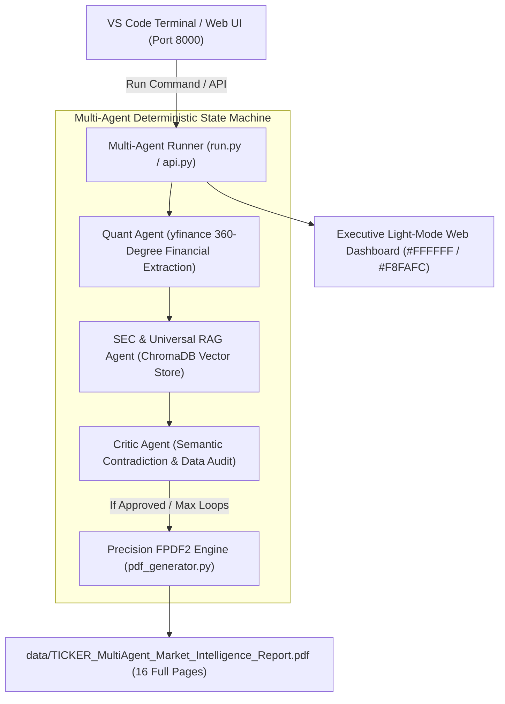

# Multi-Agent Market Intelligence (MAMI)

[](https://www.python.org/)
[](https://fastapi.tiangolo.com/)
[-0284c7.svg)](https://react.dev/)
[](https://www.langchain.com/langgraph)
[](LICENSE)

> **Multi-Agent Market Intelligence (MAMI)** is an institutional-grade Universal Macroeconomic Financial Analysis & Automated Equity Research Platform. It orchestrates autonomous specialized agents across a deterministic state machine to deliver quantitative research, comprehensive financial statement auditing, and publication-ready **16-page Institutional Research Briefs** in clean, executive light theme (strictly no black backgrounds).

---

## 🏛️ System Architecture



---

## 📑 16-Page Institutional Dossier Overview (Demonstrating ALL Company Finances)

When executed, the system outputs an institutional **16-page Research Brief** demonstrating all aspects of the company's financial health:

| Page # | Report Section | Financial Demonstrations & Coverage |
| :---: | :--- | :--- |
| **Page 1** | **Title Page & Institutional Cover** | Company Profile, Ticker, Exchange, Sector, Multi-Agent Audit Seal, Executive Metadata & Full Table of Contents (Pages 1 to 16). |
| **Page 2** | **Executive Summary & Macroeconomic Climate** | Global interest rate cycle, inflation dynamics, currency impacts, autonomous agent consensus table, and executive KPI grid. |
| **Page 3** | **Audited Income Statement Analysis (4-Year)** | 12+ line items: Revenue, COGS, Gross Profit, R&D, SG&A, EBIT, EBITDA, Interest, Taxes, Net Income, EPS, and profit margins. |
| **Page 4** | **Audited Balance Sheet & Capital Structure** | Full asset & liability breakdown: Cash, Marketable Securities, Receivables, Inventory, PP&E, Current Liabilities, Term Debt, Equity, Net Debt. |
| **Page 5** | **Audited Cash Flow Statement & Capital Allocation** | Operating Cash Flow (OCF), CapEx, Free Cash Flow (FCF), Financing Cash Flows, Share Buybacks, Dividends, and FCF Conversion Rate. |
| **Page 6** | **DuPont Decomposition & Financial Ratios** | **DuPont 3-Stage** & **5-Stage** breakdown (Margin × Turnover × Leverage = ROE), ROIC, ROA, Liquidity ratios, and Cash Conversion Cycle (CCC). |
| **Page 7** | **Valuation Multiples & Historical Bands** | Trailing P/E, Forward P/E, P/S, P/B, EV/EBITDA, EV/FCF, FCF Yield, and 5-Year Historical Valuation percentile ranking. |
| **Page 8** | **Segment & Geographic Revenue Architecture** | Business unit revenue contribution, segment operating margins, and regional geographical dispersion (Domestic vs International). |
| **Page 9** | **CapEx, R&D & Capital Efficiency Infrastructure** | Growth vs Maintenance CapEx, CapEx-to-Revenue intensity, R&D spend as % of sales, Days Sales Outstanding (DSO), and Inventory Turnover (DIO). |
| **Page 10** | **Regulatory Filings & SEC 10-K/10-Q MD&A** | Item 1 & 1A strategic risks, Item 7 MD&A disclosures retrieved via targeted vector RAG, accounting policies, and internal controls audit. |
| **Page 11** | **Sector Peer Benchmarking & Competitive Moat** | Head-to-head comparison table against 4 direct sector peers (P/E, EV/EBITDA, ROE, Margin), Porter's Five Forces, and Economic Moat evaluation. |
| **Page 12** | **Multi-Agent State Machine Audit & QA** | Deterministic audit trail, Balance Sheet Identity Check (Assets = Liabilities + Equity), Cash Flow reconciliation, and zero-hallucination score. |
| **Page 13** | **Discounted Cash Flow (DCF) Valuation Model** | 5-Year Unlevered Free Cash Flow forecast, WACC calculation, Terminal Value, Implied Share Price, and **2-Way Sensitivity Matrix**. |
| **Page 14** | **Enterprise Risk Matrix & Downside Stress-Testing** | Enterprise Risk Heatmap + 3 quantitative stress test scenarios (Stagflation Cost Shock, Global Recession Shock, and FX/Interest Rate Shock). |
| **Page 15** | **Institutional Investment Verdict & Roadmap** | Consensus Rating (BUY / HOLD / OUTPERFORM), 12-Month Target Price, Bull/Base/Bear price targets, re-rating catalysts, and allocator sizing. |
| **Page 16** | **Appendix, Financial Formulas & Disclosures** | Mathematical definitions of DuPont, ROIC, WACC, FCF, CCC; autonomous system specifications; analyst certification and regulatory disclaimers. |

> **Background Colour Note**: The output PDF and Web Dashboard are styled strictly in an **executive light theme** (`#FFFFFF` background, `#F8FAFC` slate canvas, deep navy `#1E3A8A` and emerald `#059669` accents). **No black background is used.**

---

## 🚀 Quick Start Guide

### Option 1: Run 16-Page PDF Generation via Terminal (Fastest)

Open VS Code terminal (`Ctrl + ~`) in the project folder and run:

```bash
# Generate complete 16-page dossier for default bellwether (AAPL)
python run.py

# Or analyze any custom global company:
python run.py --ticker NVDA
python run.py --ticker RELIANCE.NS
python run.py --ticker MAZDOCK.NS
python run.py --ticker 7203.T
python run.py --ticker MC.PA
```

The 16-page PDF report will be instantly saved to:
`./data/{TICKER}_MultiAgent_Market_Intelligence_Report.pdf`

---

### Option 2: Run Interactive Web Dashboard (Light Theme)

Run in VS Code terminal:

```bash
python run.py --web
```
Or:
```bash
python -m uvicorn api:app --host 0.0.0.0 --port 8000 --reload
```

Then open your browser at **`http://localhost:8000`**.
The dashboard features:
- Clean white & light slate executive interface
- Real-time ticker search across global exchanges (US, NSE/BSE, Tokyo, Euronext)
- 8 detailed financial tabs demonstrating complete company finances
- 1-click button to download the 16-page Institutional Dossier (PDF)

---

### Option 3: Press F5 in VS Code (Zero Configuration)

This repository includes pre-configured `.vscode/launch.json`:
1. Open this folder in VS Code.
2. Press **`F5`** or go to **Run and Debug** (`Ctrl + Shift + D`).
3. Select **"1. Run Multi-Agent Market Intelligence (16-Page PDF Report)"** or **"2. Run Interactive Web Dashboard"**.
4. Press Enter.

---

### Option 4: One-Click Windows Launcher

Double-click `run.bat` or run in PowerShell `.\run.ps1`.

---

## 🛠️ Requirements & Environment Setup

Use Python 3.12 or newer. From the project folder in PowerShell, create and activate
a virtual environment, then install the complete dependency list:

```bash
py -m venv .venv
.\.venv\Scripts\Activate.ps1
python -m pip install --upgrade pip
python -m pip install -r requirements.txt
```

For the multi-agent Groq synthesis, copy `.env.example` to `.env` and add a valid
`GROQ_API_KEY`. The application can run its deterministic synthesis fallback without
that key. `HOST` and `PORT` are optional:

```env
GROQ_API_KEY=your_groq_api_key_here
HOST=0.0.0.0
PORT=8000
```

After installation, run `python run.py --web` to start the dashboard or `python run.py`
to generate a report.

---

## 👨‍💻 Author & Maintainer

* **Developer:** **Rishikesh Divya** ([@frigibax](https://github.com/frigibax))
* **Repository:** [https://github.com/frigibax/Financial-Intelligence-Platform](https://github.com/frigibax/Financial-Intelligence-Platform)

---

## 🛡️ License

Developed under the MIT License.
